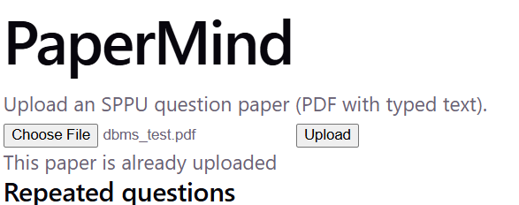

# PaperMind

AI-assisted analyzer for SPPU question papers. It finds which questions repeat across years so students can study smarter.

## Features
- Upload a question paper (PDF) and extract every question automatically
- Detect repeated questions across papers using fuzzy matching
- See all papers and which questions appear in more than one paper

## Screenshots



## Tech Stack
- Frontend: React + Vite
- Backend: Python, FastAPI
- PDF parsing: PyMuPDF
- Matching: RapidFuzz
- Database: SQLite with SQLAlchemy

## How to run
Backend:
```
cd backend
python -m venv venv
venv\Scripts\Activate.ps1
pip install fastapi uvicorn pymupdf python-multipart sqlalchemy rapidfuzz
uvicorn main:app --reload
```

Frontend:
```
cd frontend
npm install
npm run dev
```
Open http://localhost:5173

## Roadmap
- [ ] Read scanned papers and photos
- [ ] AI-generated model answers
- [ ] Chapter-wise weightage charts
- [ ] Live deployment